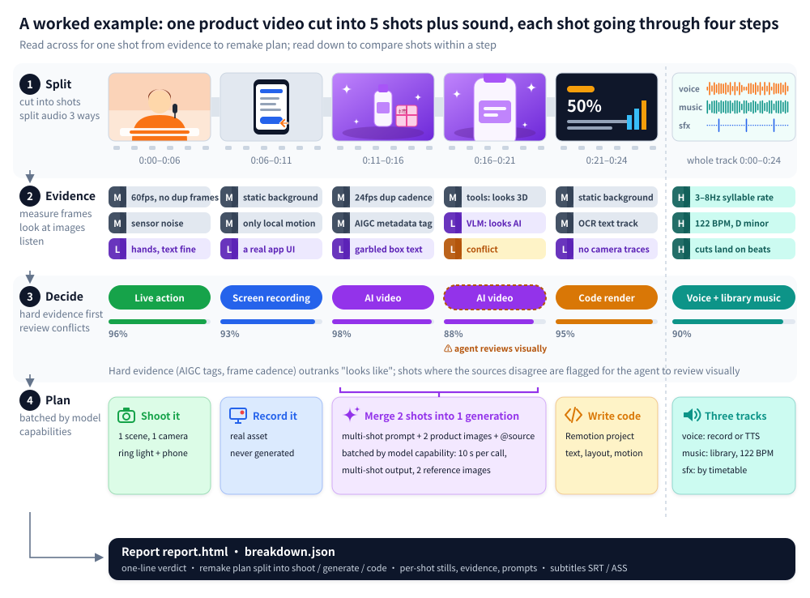

<div align="center">

<picture>
  <source media="(prefers-color-scheme: dark)" srcset="docs/brand/logo-light.svg">
  
</picture>

Reverse-engineer any video.

Shot by shot: was it filmed, AI-generated or coded, and how to remake it.

[Upstream site](https://www.reavideo.ai) | [中文](i18n/README_zh.md) | English | [Русский](i18n/README_ru.md) | [日本語](i18n/README_ja.md) | [한국어](i18n/README_ko.md) | [Español](i18n/README_es.md) | [Português](i18n/README_pt.md) | [Français](i18n/README_fr.md) | [Deutsch](i18n/README_de.md)


Project source: [rea-ziyanai branch](https://github.com/ziyan-ai/ZIYANmuse/tree/rea-ziyanai) in the existing ZIYANmuse repository.
</div>

## Quick start

rea-ziyanai is built for AI agents. In Claude Code, Codex or any agent that can run commands, say:

```text
Install https://github.com/ziyan-ai/ZIYANmuse/tree/rea-ziyanai, then break down this video: /path/to/video.mp4
```

The agent installs the CLI, learns the workflow and runs the whole thing. You need ffmpeg and Python 3.10+.

<details><summary>Install by hand</summary>

```bash
brew install ffmpeg            # or: sudo apt install ffmpeg
git clone --branch rea-ziyanai https://github.com/ziyan-ai/ZIYANmuse.git rea-ziyanai && cd rea-ziyanai
bash scripts/install_skill.sh  # installs the CLI (pip, or pipx / a local .venv if pip is blocked) and links the skill into ~/.claude, ~/.codex, ~/.agents
rea-ziyanai --help
```

</details>

You get:

- a concise summary of production methods, audio and real-footage findings
- a remake plan, split into what to film, what to generate and what to code
- a full `report.html` with per-shot frames, evidence, prompts, camera and lighting notes, and the audio breakdown

You can also hook up a video-capable model (Gemini or Doubao both work) by giving the agent its endpoint and key. That makes the live/AI/3D calls more accurate and adds a reverse-engineered prompt for every shot. It works fine without one; if your agent can see images, it checks the uncertain shots itself.

> Reports are written in whichever language you ask in (Chinese or English). 

## What it can break down

| Video type | Analysis |
|---|---|---|
| Live footage | Camera setup, framing, movement, lighting and color |
| AI video | Evidence, per-shot prompts and model-aware batching plan |
| Avatar | Avatar-shot detection and required portrait/audio assets |
| 3D / animation | Choice between video generation and 3D/code rendering |
| Code / template | Text, layout, motion timing and Remotion-ready specifications |
| Screen recording | Identification of real screen-capture material |
| Mixed / edits | Per-shot findings reassembled on the original timeline |

Besides how the visuals were made, every breakdown also covers:

- Captions and styled text: start and end of each line (exports to SRT / ASS), plus color, outline and how the text comes in
- Stickers, emoji, picture-in-picture: where they sit and how long they stay
- Editing: where the cuts are, how fast, whether they hit the beat
- Audio: human or AI voice, AI or library music and its BPM, where each sound effect lands
- Material you'll need to supply yourself: screen recordings, screenshots, product photos

## Accuracy

Accuracy of the how-it-was-made call, weighted by shot duration:

| | Tuning set (15) | Holdout (16) | Re-encoded WeChat videos (10) |
|---|---|---|---|
| Tools only (offline, free) | 98.3% | 99.6% / 98.9% | 88.6% |
| + vision model (Gemini) | — | 99.6% / 99.8% | 99.6% |
| + agent visual review | — | 99.6% / 99.8% | 100% |

The Holdout column shows two numbers: holdout (9 videos) and holdout2 (7 videos).

On original files, the tools alone are usually enough. Videos downloaded from platforms have been recompressed, which wipes out the noise evidence, so you need a visual check to get back above 99%.

Real-asset detection is 97–99%, and shot boundaries are all correct. Numbers and how to reproduce them: [eval/RESULTS.md](eval/RESULTS.md).

## How it works



1. Split: cut the video into shots and split the audio into voice, music and effects.
2. Gather evidence: measure (frame cadence, sensor noise, whether the whole image moves as one flat plane, AIGC tags in the metadata), look (hands, text, physics) and listen (BPM, key, singing vs speech).
3. Decide: hard evidence like AIGC tags and frame cadence beats "looks like". Conflicts get flagged for the agent to check visually.
4. Plan the remake: batch shots according to what the target video model can actually do, such as max clip length, multi-shot support and how many reference images it takes.

## FAQ

<details>
<summary>How is this different from one-click remake tools like Hypit?</summary>

[Hypit](https://github.com/hypit-ai/hypit) takes a reference video and makes a new one: the agent reads frame grids to understand the original, generates footage with the models it supports (Seedance, PixVerse, MiniMax, Wan and others), and renders captions and motion graphics in HTML.

It doesn't ask how the original was made. A live-action source goes through the same pipeline; it won't tell you how many cameras were used or how it was lit. What AI video it can match depends on the models it supports: no Kling or Veo, no dedicated avatar or 3D path, and no AI music (you bring your own). It's strongest on talking-head, podcast and interview videos that follow a script, and weaker on music-driven edits, product motion graphics and cinematic shorts.

rea-ziyanai doesn't render a video. It works out shot by shot whether something was filmed, AI-generated or built in code, then gives a shooting plan, prompts or a code approach for each. For a quick lookalike, Hypit is faster. To understand how the original was made and remake it cheaply, use rea-ziyanai. They work fine together.

</details>

<details>
<summary>Do I need a video-capable model? What does it cost?</summary>

No. Tools-only mode is offline and free, and already accurate on original files. For recompressed platform downloads, add a video-capable model (Gemini or Doubao both work) or use an agent that can see images; you pay whatever that service charges. Automatic video generation (capsule-cinema) does a free dry run first and only calls paid models after you confirm.

</details>

<details>
<summary>Can it remake the whole video automatically?</summary>

Partly. With [capsule-cinema](https://github.com/JuneYaooo/capsule-cinema) installed, AI shots are generated and placed back on the original timeline automatically. You film the live shots from the shooting plan, and the agent writes the code shots as a Remotion project. See [docs/replicate.md](docs/replicate.md).

</details>

<details>
<summary>Can I just repost someone else's video?</summary>

No. rea-ziyanai is for learning a video's structure, pacing and techniques, then remaking it with material you have the rights to. Don't reuse other people's footage, music, characters or likeness. Follow platform rules and local AI-content labeling requirements when you publish.

</details>

## Docs

- [docs/what-it-detects.md](docs/what-it-detects.md): everything it detects (10 visual types, camera, lighting, grade, audio)
- [docs/replicate.md](docs/replicate.md): how to remake from the report
- [docs/decompose.md](docs/decompose.md): detection rules
- [docs/cli.md](docs/cli.md): CLI usage and capsule-cinema integration
- [rea_video/capabilities/](rea_video/capabilities/README.md): capability tables for video / image / audio models, used to pick models for the remake plan
- [eval/RESULTS.md](eval/RESULTS.md): eval results

Chinese documentation: [local agent setup](docs/local-agent-setup.md), [video detection](docs/what-it-detects.md), [remake guide](docs/replicate.md), [CLI reference](docs/cli.md).

## Community

Questions, breakdowns and remake ideas: [GitHub Discussions](https://github.com/ziyan-ai/ZIYANmuse/discussions). Chat with us on [Discord](https://discord.gg/dZj8D3GqWT). Chinese speakers can also find us on [linux.do](https://linux.do/).


## Credits

Inspired by [REA (Reverse Engineer Anything)](https://github.com/morluto/rea): work back from what you see to how it was made, back every claim with evidence, and verify by measuring.
