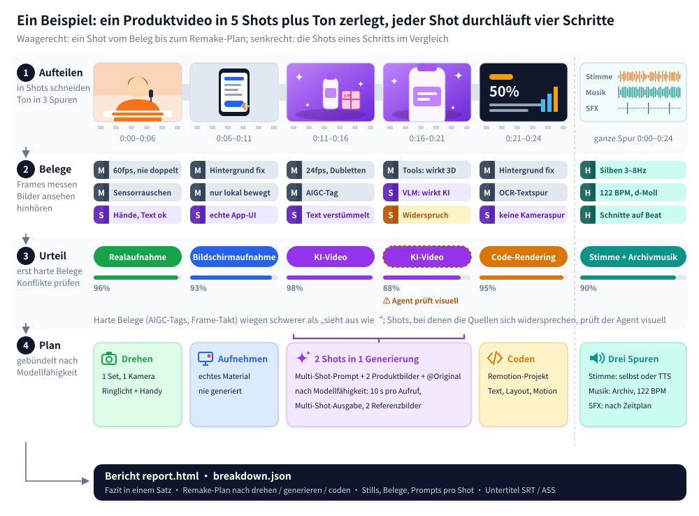

<div align="center">

<picture>
  <source media="(prefers-color-scheme: dark)" srcset="../docs/brand/logo-light.svg">
  
</picture>

Reverse Engineering für beliebige Videos.

Shot für Shot: gedreht, mit KI generiert oder programmiert? Und wie baut man es nach?

[Upstream site](https://www.reavideo.ai) | [中文](README_zh.md) | [English](../README.md) | [Русский](README_ru.md) | [日本語](README_ja.md) | [한국어](README_ko.md) | [Español](README_es.md) | [Português](README_pt.md) | [Français](README_fr.md) | Deutsch


⭐ *Mit einem Stern hilfst du, dass mehr Leute rea-ziyanai finden.*
</div>

## Schnellstart

rea-ziyanai ist für KI-Agenten gemacht. Schreib in Claude Code, Codex oder einem anderen Agenten, der Befehle ausführen kann:

```text
Installiere https://github.com/ziyan-ai/ZIYANmuse/tree/rea-ziyanai und nimm dann dieses Video auseinander: /path/to/video.mp4
```

Der Agent installiert die CLI, liest sich in den Ablauf ein und erledigt den Rest. Voraussetzung sind ffmpeg und Python 3.10+.

<details><summary>Manuell installieren</summary>

```bash
brew install ffmpeg            # sudo apt install ffmpeg
git clone --branch rea-ziyanai https://github.com/ziyan-ai/ZIYANmuse.git rea-ziyanai && cd rea-ziyanai
bash scripts/install_skill.sh  # installiert die CLI (pip, sonst pipx / lokales .venv) und verlinkt den Skill → ~/.claude, ~/.codex, ~/.agents
rea-ziyanai --help
```

</details>

Am Ende hast du:

- eine knappe Zusammenfassung von Produktionsweise, Audioanalyse und echtem Material
- einen Remake-Plan, aufgeteilt in: was du drehst, was du generierst und was du programmierst
- einen vollständigen `report.html` mit Frames zu jedem Shot, Belegen, Prompts, Notizen zu Kamera und Licht und der Audioanalyse

Optional kannst du ein Modell anbinden, das Video versteht – Gemini oder Doubao, beides geht: Gib dem Agenten einfach Endpoint und Key. Dann wird die Einstufung echt/KI/3D genauer, und zu jedem Shot gibt es einen rekonstruierten Prompt. Ohne Modell geht es auch; kann dein Agent Bilder sehen, schaut er sich die unsicheren Shots selbst an.

> Der Bericht kommt in der Sprache, in der du fragst (Chinesisch oder Englisch). Die Beispielberichte unten sind auf Englisch.

## Was sich analysieren lässt

| Videotyp | Beispiele | Was du bekommst |
|---|---|---|
| Realaufnahmen | Talking Head, Tabletop, Produktdemo aus der Hand, Vlog, Ladenbesuch | Sets und Kamerapositionen, Bildausschnitt, Kamerabewegungen, Licht (12 Setups mit Ausrüstungslisten), Color Grading |
| KI-Video | Text/Bild-zu-Video, KI-Kurzserie, KI-Musikvideo | Belege, ein rekonstruierter Prompt pro Shot, wie sich die Shots auf Generierungen verteilen lassen und welches Modell passt |
| Avatar | Porträt, das per Audio animiert wird; Lipsync | Welche Shots Avatar-Shots sind und welches Porträt und Audio du dafür brauchst |
| 3D / Animation | Blender- / C4D-Erklärvideos, Produktanimation, 2D-Animation, Stop-Motion | Ob du besser mit einem Videomodell generierst oder per 3D-Code renderst |
| Code / Vorlage | Kinetische Typografie, UI-Demos, Diagramme, Karten im Folienstil | Text, Layout und Animations-Timing – direkt als Remotion-Projekt nachbaubar |
| Bildschirmaufnahme | Software-Tutorials, Web-Demos | Welche Teile echtes Material sind, das du selbst aufnehmen musst |
| Gemischt / Schnitte | KI-Figuren + Code-UI + echte Bildschirmaufnahme; echtes Filmmaterial mit KI-Bearbeitung | Jeder Shot wird einzeln bewertet und danach auf der Original-Timeline wieder zusammengesetzt |

Unabhängig davon, wie das Bild entstanden ist, schaut sich rea-ziyanai bei jedem Video außerdem an:

- Untertitel und Texteinblendungen: Start und Ende jeder Zeile (Export als SRT / ASS), dazu Farbe, Kontur und wie der Text reinkommt
- Sticker, Emoji, Bild-in-Bild: wo sie sitzen und wie lange sie bleiben
- Schnitt: wo geschnitten wird, in welchem Tempo und ob die Schnitte auf dem Beat liegen
- Audio: echte oder KI-Stimme, KI- oder Stockmusik samt BPM, wo welcher Soundeffekt sitzt
- Material, das du selbst beisteuern musst: Bildschirmaufnahmen, Screenshots, Produktfotos

## Genauigkeit

Wie zuverlässig rea-ziyanai erkennt, wie ein Shot entstanden ist (gewichtet nach Shot-Länge):

| | Tuning-Set (15) | Holdout (16) | Neu kodierte WeChat-Videos (10) |
|---|---|---|---|
| Nur Tools (offline, kostenlos) | 98.3% | 99.6% / 98.9% | 88.6% |
| + Vision-Modell (Gemini) | — | 99.6% / 99.8% | 99.6% |
| + visuelle Prüfung durch den Agenten | — | 99.6% / 99.8% | 100% |

Die beiden Holdout-Werte gelten für holdout (9 Videos) bzw. holdout2 (7 Videos).

Bei Originaldateien reichen meist schon die Tools. Von Plattformen heruntergeladene Videos sind neu komprimiert, dabei gehen die Rauschspuren verloren – um wieder über 99 % zu kommen, braucht es dann eine visuelle Prüfung.

Echte Assets werden zu 97–99 % erkannt, die Shot-Grenzen stimmen alle. Zahlen und wie du sie reproduzierst: [eval/RESULTS.md](../eval/RESULTS.md).

## Wie es funktioniert



1. Zerlegen: Video in Shots schneiden, Ton in Stimme, Musik und Effekte trennen.
2. Belege sammeln: Frames vermessen (Frame-Takt, Sensorrauschen, ob sich das ganze Bild wie eine einzige Ebene verschiebt, AIGC-Tags in den Metadaten), Bilder anschauen (Hände, Text, Physik), hinhören (BPM, Tonart, Gesang oder Sprache).
3. Entscheiden: Harte Belege wie AIGC-Tags und Frame-Takt zählen mehr als „sieht aus wie“. Widersprüche werden markiert, damit der Agent sie sich ansieht.
4. Remake planen: Shots so bündeln, wie es das Ziel-Videomodell tatsächlich hergibt – maximale Cliplänge, Multi-Shot-Support, wie viele Referenzbilder es nimmt.


## FAQ

<details>
<summary>Was ist der Unterschied zu Ein-Klick-Remake-Tools wie Hypit?</summary>

[Hypit](https://github.com/hypit-ai/hypit) macht aus einem Referenzvideo ein neues: Der Agent liest Frame-Raster, um das Original zu verstehen, generiert Material mit den unterstützten Modellen (Seedance, PixVerse, MiniMax, Wan und andere) und rendert Untertitel und Motion Graphics in HTML.

Wie das Original entstanden ist, spielt dabei keine Rolle. Eine Realfilm-Vorlage läuft durch dieselbe Pipeline; wie viele Kameras im Einsatz waren oder wie ausgeleuchtet wurde, erfährst du nicht. Welche KI-Videos es nachbauen kann, hängt von seinen Modellen ab: kein Kling, kein Veo, kein eigener Avatar- oder 3D-Weg und keine KI-Musik – die musst du selbst mitbringen. Stark ist es bei Talking-Head-, Podcast- und Interview-Videos nach Skript, schwächer bei musikgetriebenen Schnitten, Produkt-Motion-Graphics und filmischen Kurzfilmen.

rea-ziyanai rendert kein Video. Es klärt Shot für Shot, ob etwas gedreht, mit KI generiert oder in Code gebaut wurde, und liefert dazu jeweils einen Drehplan, Prompts oder einen Code-Ansatz. Wer schnell etwas Ähnliches haben will, ist mit Hypit schneller. Wer verstehen will, wie das Original gemacht ist, und es günstig nachbauen möchte, nimmt rea-ziyanai. Die beiden vertragen sich gut.

</details>

<details>
<summary>Brauche ich ein Modell, das Video versteht? Was kostet das?</summary>

Nein. Der reine Tool-Modus läuft offline, kostet nichts und ist bei Originaldateien schon genau. Für neu komprimierte Downloads von Plattformen nimmst du ein videofähiges Modell dazu (Gemini oder Doubao, beides geht) oder einen Agenten, der Bilder sehen kann; bezahlt wird, was der jeweilige Dienst verlangt. Die automatische Videogenerierung (capsule-cinema) macht vorher einen kostenlosen Testlauf und ruft kostenpflichtige Modelle erst auf, wenn du bestätigst.

</details>

<details>
<summary>Baut es das ganze Video automatisch nach?</summary>

Teilweise. Mit installiertem [capsule-cinema](https://github.com/JuneYaooo/capsule-cinema) werden KI-Shots automatisch generiert und wieder an ihre Stelle in der Original-Timeline gesetzt. Realfilm-Shots drehst du selbst nach Drehplan, Code-Shots schreibt der Agent als Remotion-Projekt. Mehr dazu in [docs/replicate.md](../docs/replicate.md).

</details>

<details>
<summary>Kann ich einfach fremde Videos neu hochladen?</summary>

Nein. rea-ziyanai ist dafür gedacht, Aufbau, Tempo und Technik eines Videos zu verstehen und es dann mit Material nachzubauen, an dem du die Rechte hast. Fremdes Filmmaterial, fremde Musik, Figuren oder das Abbild anderer Personen sind tabu. Beim Veröffentlichen gelten die Regeln der Plattform und die Kennzeichnungspflichten für KI-Inhalte in deinem Land.

</details>

## Dokumentation

- [docs/what-it-detects.md](../docs/what-it-detects.md): alles, was erkannt wird (10 Bildtypen, Kamera, Licht, Grading, Audio)
- [docs/replicate.md](../docs/replicate.md): nachbauen anhand des Berichts
- [docs/decompose.md](../docs/decompose.md): Erkennungsregeln
- [docs/cli.md](../docs/cli.md): CLI-Nutzung und capsule-cinema-Integration
- [rea_video/capabilities/](../rea_video/capabilities/README.md): Fähigkeitstabellen für Video-, Bild- und Audiomodelle; danach werden die Modelle für den Remake-Plan ausgewählt
- [eval/RESULTS.md](../eval/RESULTS.md): Evaluationsergebnisse

Die Doku gibt es vorerst nur auf Chinesisch.

## Community

Fragen, Analysen und Remake-Ideen gehören in die [GitHub Discussions](https://github.com/ziyan-ai/ZIYANmuse/discussions). Zum Quatschen gibt es unseren [Discord](https://discord.gg/dZj8D3GqWT). Wer Chinesisch spricht, findet uns auch auf [linux.do](https://linux.do/).

Du willst ein bestimmtes Video analysiert haben? Mach ein [Request-Issue](https://github.com/ziyan-ai/ZIYANmuse/issues/new?template=request_breakdown.yml) mit dem Link auf, dann veröffentlichen wir das Ergebnis als Fallbeispiel.

## Danksagung

Inspiriert von [REA (Reverse Engineer Anything)](https://github.com/morluto/rea): vom Sichtbaren aus zurückverfolgen, wie es entstanden ist, jede Aussage mit Belegen untermauern und per Messung überprüfen.
