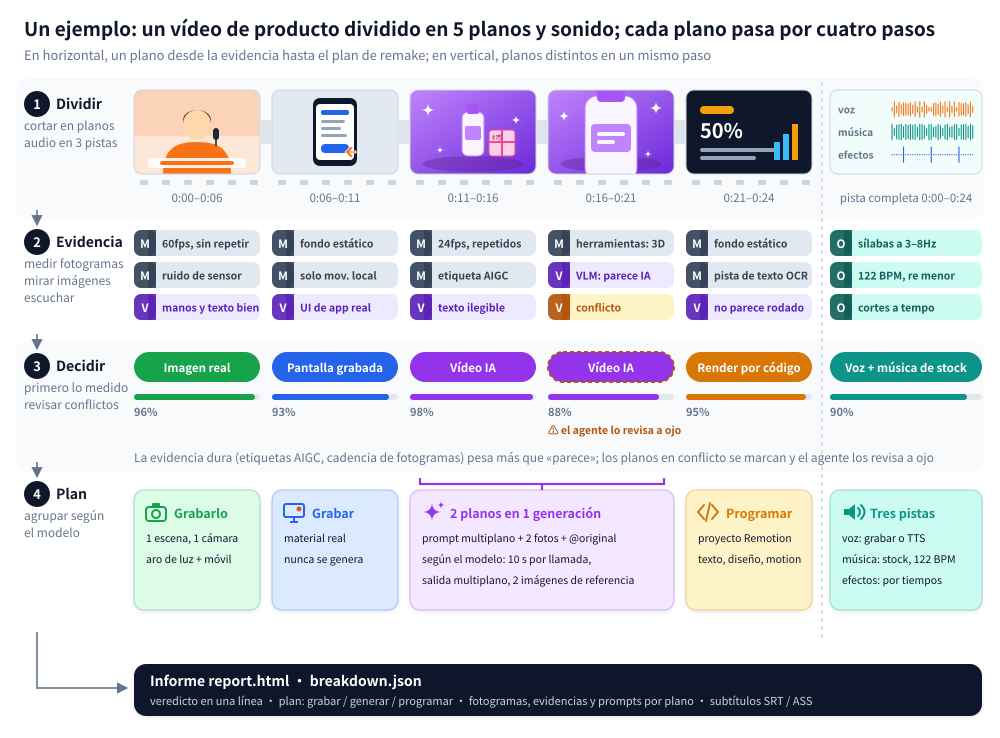

<div align="center">

<picture>
  <source media="(prefers-color-scheme: dark)" srcset="../docs/brand/logo-light.svg">
  
</picture>

Ingeniería inversa para cualquier vídeo.

Plano a plano: si se grabó, se generó con IA o se hizo con código, y cómo volver a hacerlo.

[Sitio web](https://www.reavideo.ai) | [中文](README_zh.md) | [English](../README.md) | [Русский](README_ru.md) | [日本語](README_ja.md) | [한국어](README_ko.md) | Español | [Português](README_pt.md) | [Français](README_fr.md) | [Deutsch](README_de.md)


⭐ *Si te sirve, dale una estrella: así más gente encuentra rea-ziyanai.*
</div>

## Inicio rápido

rea-ziyanai está pensado para usarse desde un agente de IA. En Claude Code, Codex o cualquier agente que pueda ejecutar comandos, escribe:

```text
Instala https://github.com/ziyan-ai/ZIYANmuse/tree/rea-ziyanai y luego analiza este vídeo: /path/to/video.mp4
```

El agente instala la CLI, aprende el flujo de trabajo y se encarga del resto. Solo necesitas ffmpeg y Python 3.10+.

<details><summary>Instalación manual</summary>

```bash
brew install ffmpeg            # sudo apt install ffmpeg
git clone --branch rea-ziyanai https://github.com/ziyan-ai/ZIYANmuse.git rea-ziyanai && cd rea-ziyanai
bash scripts/install_skill.sh  # instala la CLI (pip, o pipx / .venv local) y enlaza el skill → ~/.claude, ~/.codex, ~/.agents
rea-ziyanai --help
```

</details>

Lo que obtienes:

- un resumen breve del método de producción, el audio y el material real
- un plan para rehacerlo, separado en qué hay que grabar, qué generar y qué programar
- un `report.html` completo con fotogramas por plano, evidencias, prompts, notas de cámara e iluminación, y el desglose del audio

Si añades un modelo que entienda vídeo (vale Gemini o Doubao), basta con pasarle al agente el endpoint y la clave. Con él acierta más al distinguir entre imagen real, IA y 3D, y reconstruye el prompt de cada plano. Sin él también funciona: si tu agente puede ver imágenes, revisa él mismo los planos dudosos.

> El informe sale en el idioma en que lo pidas (chino o inglés). Los informes de ejemplo de más abajo están en inglés.

## Qué tipo de vídeos analiza

| Tipo de vídeo | Ejemplos | Qué obtienes |
|---|---|---|
| Imagen real | Vídeo a cámara, tabletop, demo de producto en mano, vlog, visita a tienda | Montajes de rodaje y posiciones de cámara, encuadre, movimientos de cámara, iluminación (12 esquemas, cada uno con su lista de equipo), etalonaje |
| Vídeo con IA | Texto/imagen a vídeo, microdramas con IA, videoclips con IA | Evidencias, el prompt reconstruido de cada plano, cómo agruparlos en generaciones y qué modelo usar |
| Avatar | Un retrato animado a partir de audio, sincronización labial | Qué planos son de avatar y qué retrato y audio necesitas |
| 3D / animación | Vídeos explicativos en Blender / C4D, animación de producto, animación 2D, stop-motion | Si conviene generarlo con un modelo de vídeo o renderizarlo con código 3D |
| Código / plantilla | Tipografía cinética, demos de UI, gráficos, tarjetas tipo diapositiva | Texto, maquetación y tiempos de animación, listos para rehacerlo como proyecto de Remotion |
| Grabación de pantalla | Tutoriales de software, demos web | Qué partes son material real que tendrás que grabar tú |
| Mixto / montajes | Personajes de IA + UI en código + captura de pantalla real; imagen real con retoques de IA | Cada plano se analiza por separado y después todo se vuelve a montar sobre la línea de tiempo original |

Además de cómo se hizo la imagen, de cada vídeo se analiza:

- Subtítulos y rótulos: dónde empieza y termina cada línea (se puede exportar a SRT / ASS), además del color, el contorno y cómo entra el texto
- Stickers, emojis, picture-in-picture: dónde aparecen y cuánto duran
- Montaje: dónde están los cortes, a qué ritmo van y si caen a tempo
- Audio: si la voz es humana o de IA, si la música es de IA o de biblioteca y a cuántos BPM va, y dónde cae cada efecto de sonido
- El material que tendrás que poner tú: grabaciones de pantalla, capturas, fotos de producto

## Precisión

Precisión al identificar cómo se hizo cada plano, ponderada por su duración:

| | Conjunto de ajuste (15) | Holdout (16) | Vídeos de WeChat recodificados (10) |
|---|---|---|---|
| Solo herramientas (offline, gratis) | 98.3% | 99.6% / 98.9% | 88.6% |
| + modelo de visión (Gemini) | — | 99.6% / 99.8% | 99.6% |
| + revisión visual del agente | — | 99.6% / 99.8% | 100% |

En la columna de holdout, la primera cifra es holdout (9 vídeos) y la segunda, holdout2 (7 vídeos).

Con los archivos originales, las herramientas solas suelen bastar. Los vídeos descargados de plataformas vienen recomprimidos y pierden la evidencia del ruido, así que para volver a pasar del 99 % hace falta una revisión visual.

La detección de material real acierta entre un 97 y un 99 %, y todos los cortes entre planos salen bien. Las cifras y cómo reproducirlas, en [eval/RESULTS.md](../eval/RESULTS.md).

## Cómo funciona



1. Separar: corta el vídeo en planos y divide el audio en voz, música y efectos.
2. Reunir evidencias: mide los fotogramas (cadencia, ruido del sensor, si toda la imagen se desplaza como un único plano, etiquetas AIGC en los metadatos), mira las imágenes (manos, texto, física) y escucha el audio (BPM, tonalidad, si se canta o se habla).
3. Decidir: las pruebas objetivas, como las etiquetas AIGC o la cadencia de fotogramas, pesan más que un "parece que". Cuando hay contradicciones, se marcan para que el agente las revise a ojo.
4. Planificar el remake: agrupa los planos según lo que de verdad puede hacer el modelo de vídeo que vayas a usar: duración máxima del clip, si admite varios planos seguidos y cuántas imágenes de referencia acepta.


## Preguntas frecuentes

<details>
<summary>¿En qué se diferencia de herramientas de remake en un clic como Hypit?</summary>

[Hypit](https://github.com/hypit-ai/hypit) parte de un vídeo de referencia y hace uno nuevo: el agente lee cuadrículas de fotogramas para entender el original, genera las imágenes con los modelos que soporta (Seedance, PixVerse, MiniMax, Wan y otros) y renderiza los subtítulos y los motion graphics en HTML.

No se plantea cómo se hizo el original. Un vídeo de imagen real pasa por el mismo pipeline, así que no te va a decir cuántas cámaras había ni cómo se iluminó. Qué vídeos de IA puede igualar depende de los modelos que tiene: no incluye Kling ni Veo, no tiene una vía propia para avatares o 3D, y tampoco hace música con IA: esa la pones tú. Va mejor con vídeos a cámara, podcasts y entrevistas que siguen un guion, y peor con montajes que van al ritmo de la música, motion graphics de producto y cortos de estilo cinematográfico.

rea-ziyanai no renderiza vídeo. Averigua plano a plano si se grabó, se generó con IA o se hizo con código, y para cada uno te da un plan de rodaje, prompts o cómo enfocarlo en código. Si lo que buscas es un vídeo parecido cuanto antes, Hypit va más rápido. Si quieres entender cómo se hizo el original y rehacerlo gastando poco, usa rea-ziyanai. Se pueden usar juntos sin problema.

</details>

<details>
<summary>¿Necesito un modelo que entienda vídeo? ¿Cuánto cuesta?</summary>

No. El modo solo con herramientas funciona offline, es gratis y con archivos originales ya acierta mucho. Para vídeos descargados de plataformas, que vienen recomprimidos, añade un modelo que entienda vídeo (vale Gemini o Doubao) o usa un agente que pueda ver imágenes; pagas lo que cobre ese servicio. La generación automática de vídeo (capsule-cinema) hace primero una simulación gratis y no llama a ningún modelo de pago hasta que tú lo confirmes.

</details>

<details>
<summary>¿Puede rehacer el vídeo entero de forma automática?</summary>

En parte. Si tienes instalado [capsule-cinema](https://github.com/JuneYaooo/capsule-cinema), los planos de IA se generan y se colocan solos en la línea de tiempo original. Los de imagen real los grabas tú siguiendo el plan de rodaje, y los de código los escribe el agente como proyecto de Remotion. Más detalles en [docs/replicate.md](../docs/replicate.md).

</details>

<details>
<summary>¿Puedo resubir sin más el vídeo de otra persona?</summary>

No. rea-ziyanai sirve para aprender de un vídeo su estructura, su ritmo y sus técnicas, y luego rehacerlo con material sobre el que tengas derechos. No reutilices las imágenes, la música, los personajes ni la imagen de otras personas. Cuando publiques, cumple las normas de la plataforma y lo que exija la ley de tu país sobre etiquetar contenido generado con IA.

</details>

## Documentación

- [docs/what-it-detects.md](../docs/what-it-detects.md): todo lo que detecta (10 tipos de imagen, cámara, iluminación, etalonaje, audio)
- [docs/replicate.md](../docs/replicate.md): cómo rehacer el vídeo a partir del informe
- [docs/decompose.md](../docs/decompose.md): reglas de detección
- [docs/cli.md](../docs/cli.md): uso de la CLI e integración con capsule-cinema
- [rea_video/capabilities/](../rea_video/capabilities/README.md): tablas de capacidades de modelos de vídeo / imagen / audio, que se usan para elegir modelo en el plan de remake
- [eval/RESULTS.md](../eval/RESULTS.md): resultados de la evaluación

De momento, la documentación solo está en chino.

## Comunidad

Para dudas, análisis e ideas de remake: [GitHub Discussions](https://github.com/ziyan-ai/ZIYANmuse/discussions). También estamos en [Discord](https://discord.gg/dZj8D3GqWT), y si hablas chino, en [linux.do](https://linux.do/).

¿Quieres que analicemos un vídeo? Abre una [issue de solicitud](https://github.com/ziyan-ai/ZIYANmuse/issues/new?template=request_breakdown.yml) con el enlace y publicaremos el resultado como un caso más.

## Créditos

Inspirado en [REA (Reverse Engineer Anything)](https://github.com/morluto/rea): partir de lo que se ve para llegar a cómo se hizo, respaldar cada afirmación con pruebas y comprobarlo midiendo.
