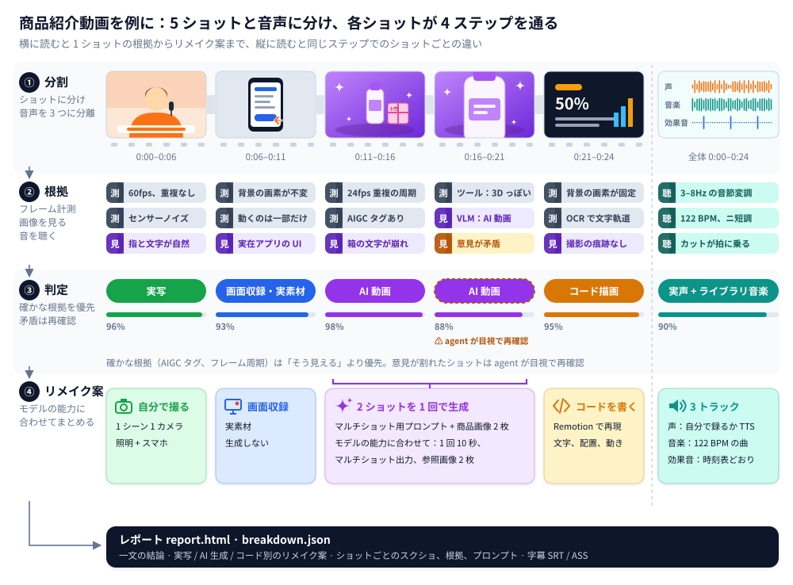

<div align="center">

<picture>
  <source media="(prefers-color-scheme: dark)" srcset="../docs/brand/logo-light.svg">
  
</picture>

どんな動画でも、どう作られたかを逆算します。

ショット単位で「実写か、AI 生成か、コードで作ったか」を見分けて、作り直し方まで出します。

[公式サイト](https://www.reavideo.ai) | [中文](README_zh.md) | [English](../README.md) | [Русский](README_ru.md) | 日本語 | [한국어](README_ko.md) | [Español](README_es.md) | [Português](README_pt.md) | [Français](README_fr.md) | [Deutsch](README_de.md)


⭐ *役に立ったら Star してもらえると、rea-ziyanai がもっと多くの人に届きます*
</div>

## クイックスタート

rea-ziyanai は AI エージェントから使う前提で作っています。Claude Code や Codex など、コマンドを実行できるエージェントにこう頼むだけです。

```text
https://github.com/ziyan-ai/ZIYANmuse/tree/rea-ziyanai をインストールして、この動画を分解して：/path/to/video.mp4
```

CLI のインストールから使い方の把握、実行まで、エージェントが全部やってくれます。必要なのは ffmpeg と Python 3.10 以上です。

<details><summary>手動でインストールする場合</summary>

```bash
brew install ffmpeg            # sudo apt install ffmpeg
git clone --branch rea-ziyanai https://github.com/ziyan-ai/ZIYANmuse.git rea-ziyanai && cd rea-ziyanai
bash scripts/install_skill.sh  # CLI をインストール（pip、ダメなら pipx / ローカル .venv）し、skill をリンク → ~/.claude, ~/.codex, ~/.agents
rea-ziyanai --help
```

</details>

出てくるもの：

- 制作方法、音声分析、実写素材を簡潔にまとめた結論
- 「撮るもの」「生成するもの」「コードで作るもの」に分けたリメイクプラン
- `report.html`：ショットごとのフレーム、判定の根拠、プロンプト、カメラ・照明のメモ、音声の分析がひととおり入ったレポート

動画を読めるモデル（Gemini でも Doubao でも OK）を足すなら、エンドポイントとキーをエージェントに渡してください。実写 / AI / 3D の判定が正確になり、全ショット分の逆算プロンプトも書いてくれます。モデルなしでも動きますし、エージェントが画像を見られるなら、判定があやしいショットはエージェントが自分で確認します。

> レポートは質問したときの言語（中国語か英語）で出ます。下の事例レポートは日本語訳です。

## 分解できる動画

| 動画の種類 | 例 | わかること |
|---|---|---|
| 実写 | トーク動画、卓上撮影、手持ちの商品紹介、Vlog、店舗訪問 | セットとカメラ位置、構図、カメラワーク、照明（機材リスト付きの 12 パターン）、カラーグレーディング |
| AI 動画 | テキスト / 画像からの動画生成、AI ショートドラマ、AI MV | 判定の根拠、ショットごとの逆算プロンプト、生成のまとめ方、使うべきモデル |
| アバター | 音声で動かす顔写真、リップシンク | どれがアバターのショットか、どんな顔写真と音声を用意すればいいか |
| 3D / アニメーション | Blender / C4D の解説動画、商品アニメーション、2D アニメ、ストップモーション | 動画モデルで生成するか、3D のコードからレンダリングするか |
| コード / テンプレート | モーションタイポグラフィ、UI デモ、グラフ、スライド風カード | テキスト、レイアウト、動きのタイミング。そのまま Remotion プロジェクトとして組み直せます |
| 画面録画 | ソフトのチュートリアル、Web のデモ | 自分で録画し直す必要がある実素材の部分 |
| 混合 / 編集もの | AI キャラ + コードの UI + 実際の画面キャプチャ、実写に AI 編集を加えたもの | ショットごとに別々に判定して、元のタイムラインに組み直します |

映像の作り方以外にも、どの動画でも次のことがわかります。

- 字幕・テロップ：各行の開始と終了（SRT / ASS に書き出し可）、色、縁取り、文字の出し方
- ステッカー、絵文字、ワイプ：どこに置かれて、どれくらい表示されるか
- 編集：どこでカットしているか、テンポ、ビートに合わせているか
- 音声：人の声か AI 音声か、AI 音楽かライブラリ音源か、その BPM、効果音がどこで鳴るか
- 自分で用意する素材：画面録画、スクリーンショット、商品写真

## 精度

制作方法の判定精度（ショットの長さで重み付け）：

| | チューニングセット (15) | ホールドアウト (16) | 再エンコードされた WeChat の動画 (10) |
|---|---|---|---|
| ツールのみ（オフライン、無料） | 98.3% | 99.6% / 98.9% | 88.6% |
| + ビジョンモデル (Gemini) | — | 99.6% / 99.8% | 99.6% |
| + エージェントによる目視確認 | — | 99.6% / 99.8% | 100% |

ホールドアウトの 2 つの数字は、holdout（9 本）と holdout2（7 本）のものです。

元ファイルなら、たいていはツールだけで足ります。プラットフォームから落とした動画は再圧縮でノイズの手がかりが消えているので、99% 超えに戻すには画像での確認が必要です。

実素材の検出精度は 97〜99% で、ショットの区切りはすべて正しく取れています。数字の詳細と再現手順は [eval/RESULTS.md](../eval/RESULTS.md) にあります。

## 仕組み



1. 分割：動画をショットに切り分け、音声を声・音楽・効果音に分けます。
2. 手がかり集め：フレームを測り（フレーム間隔、センサーノイズ、画面全体が 1 枚の平面としてパンしているか、メタデータの AIGC タグ）、画像を見て（手、文字、物理的なおかしさ）、音を聴きます（BPM、キー、歌か話し声か）。
3. 判定：AIGC タグやフレーム間隔のような確かな手がかりを、「それっぽく見える」より優先します。食い違いがあればフラグを立てて、エージェントが目で確認します。
4. リメイクの計画：1 クリップの最大長、マルチショット対応か、参照画像を何枚受け付けるかなど、使う動画モデルに実際にできることに合わせてショットをまとめます。


## FAQ

<details>
<summary>Hypit みたいなワンクリックのリメイクツールとは何が違う？</summary>

[Hypit](https://github.com/hypit-ai/hypit) は参考動画を渡すと新しい動画を作ってくれるツールです。エージェントがフレームのグリッドを読んで元動画を把握し、対応モデル（Seedance、PixVerse、MiniMax、Wan など）で映像を生成して、字幕やモーショングラフィックスは HTML でレンダリングします。

Hypit は元動画がどう作られたかを気にしません。実写の素材も同じパイプラインに流すので、カメラが何台だったか、照明をどう組んだかはわかりません。どんな AI 動画に寄せられるかも手持ちのモデル次第で、Kling や Veo はなく、アバターや 3D 専用のルートもなく、AI 音楽もないので自分で用意することになります。台本どおりに進むトーク動画、ポッドキャスト、インタビューには一番強く、音楽主導の編集、商品のモーショングラフィックス、映画的なショート動画は苦手です。

rea-ziyanai は動画をレンダリングしません。ショットごとに撮影か AI 生成かコードかを見極めて、それぞれの撮影プラン、プロンプト、コードでの作り方を出します。とりあえず似たものをさっと作りたいなら Hypit のほうが速いです。元動画がどう作られたかを理解して、安く作り直したいなら rea-ziyanai を使ってください。併用しても問題ありません。

</details>

<details>
<summary>動画を読めるモデルは必要？お金はかかる？</summary>

なくても大丈夫です。ツールのみのモードはオフラインで無料、元ファイルならこれだけで十分な精度が出ます。プラットフォームから落とした再圧縮済みの動画には、動画を読めるモデル（Gemini でも Doubao でも OK）を足すか、画像を見られるエージェントを使ってください。料金はそのサービス次第です。動画の自動生成（capsule-cinema）は、まず無料のドライランをして、確認が取れてから有料モデルを呼びます。

</details>

<details>
<summary>動画まるごと自動でリメイクできる？</summary>

一部はできます。[capsule-cinema](https://github.com/JuneYaooo/capsule-cinema) を入れておけば、AI のショットを生成して元のタイムラインに自動で戻してくれます。実写のショットは撮影プランを見ながら自分で撮り、コードのショットはエージェントが Remotion プロジェクトとして書きます。詳しくは [docs/replicate.md](../docs/replicate.md) を見てください。

</details>

<details>
<summary>他人の動画をそのまま転載してもいい？</summary>

ダメです。rea-ziyanai は、動画の構成やテンポ、テクニックを学んで、権利のある素材で作り直すためのものです。他人の映像、音楽、キャラクター、肖像を使い回さないでください。公開するときは、各プラットフォームのルールと、地域ごとの AI コンテンツ表示の決まりに従ってください。

</details>

## ドキュメント

- [docs/what-it-detects.md](../docs/what-it-detects.md)：検出できる項目の一覧（10 種類の映像タイプ、カメラ、照明、グレーディング、音声）
- [docs/replicate.md](../docs/replicate.md)：レポートからのリメイク
- [docs/decompose.md](../docs/decompose.md)：検出ルール
- [docs/cli.md](../docs/cli.md)：CLI の使い方と capsule-cinema との連携
- [rea_video/capabilities/](../rea_video/capabilities/README.md)：動画 / 画像 / 音声モデルの能力表。リメイクプランでモデルを選ぶときに使います
- [eval/RESULTS.md](../eval/RESULTS.md)：評価結果

ドキュメントは今のところ中国語だけです。

## コミュニティ

質問や分解結果、リメイクのアイデアは [GitHub Discussions](https://github.com/ziyan-ai/ZIYANmuse/discussions) へどうぞ。[Discord](https://discord.gg/dZj8D3GqWT) でも気軽に声をかけてください。中国語が読める方は [linux.do](https://linux.do/) にもいます。

分解してほしい動画があれば、リンクを付けて [issue](https://github.com/ziyan-ai/ZIYANmuse/issues/new?template=request_breakdown.yml) を立ててください。結果は事例として公開します。

## クレジット

[REA (Reverse Engineer Anything)](https://github.com/morluto/rea) から着想を得ています。目に見えるものから作り方をさかのぼり、主張にはすべて根拠を付け、測って確かめる、という考え方です。
