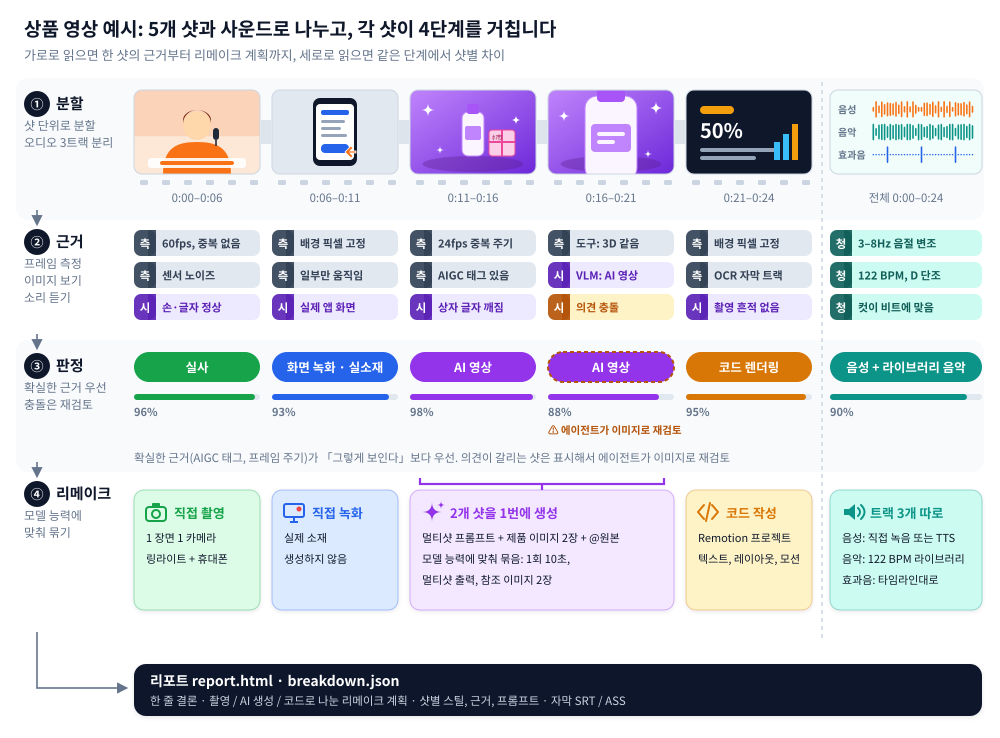

<div align="center">

<picture>
  <source media="(prefers-color-scheme: dark)" srcset="../docs/brand/logo-light.svg">
  
</picture>

어떤 영상이든 어떻게 만들었는지 리버스 엔지니어링합니다.

샷 하나하나가 직접 찍은 건지, AI로 만든 건지, 코드로 짠 건지 가려내고 다시 만드는 방법까지 알려 줍니다.

[웹사이트](https://www.reavideo.ai) | [中文](README_zh.md) | [English](../README.md) | [Русский](README_ru.md) | [日本語](README_ja.md) | 한국어 | [Español](README_es.md) | [Português](README_pt.md) | [Français](README_fr.md) | [Deutsch](README_de.md)


⭐ *더 많은 사람이 rea-ziyanai를 찾을 수 있게 Star 한 번 눌러 주세요!*
</div>

## 빠른 시작

rea-ziyanai는 AI 에이전트가 쓰라고 만든 도구입니다. Claude Code, Codex처럼 명령을 실행할 수 있는 에이전트에게 이렇게 말하면 됩니다.

```text
https://github.com/ziyan-ai/ZIYANmuse/tree/rea-ziyanai 설치하고 이 영상 분석해 줘: /path/to/video.mp4
```

CLI 설치부터 워크플로 파악, 전체 실행까지 에이전트가 알아서 합니다. ffmpeg와 Python 3.10 이상만 있으면 됩니다.

<details><summary>직접 설치하기</summary>

```bash
brew install ffmpeg            # sudo apt install ffmpeg
git clone --branch rea-ziyanai https://github.com/ziyan-ai/ZIYANmuse.git rea-ziyanai && cd rea-ziyanai
bash scripts/install_skill.sh  # CLI 설치(pip, 안 되면 pipx / 로컬 .venv) 후 skill 연결 → ~/.claude, ~/.codex, ~/.agents
rea-ziyanai --help
```

</details>

이런 결과를 받을 수 있습니다.

- 제작 방식, 오디오 분석, 실제 영상 소재를 간결하게 요약
- 무엇을 찍고, 무엇을 생성하고, 무엇을 코드로 짤지 나눠 놓은 리메이크 계획
- 샷별 프레임, 근거, 프롬프트, 카메라·조명 메모, 오디오 분석까지 다 들어 있는 `report.html`

영상을 볼 수 있는 모델(Gemini, Doubao 둘 다 됩니다)을 붙이고 싶다면 에이전트에게 엔드포인트와 키만 알려 주세요. 실사/AI/3D 판정이 더 정확해지고, 샷마다 역설계한 프롬프트도 써 줍니다. 모델이 없어도 돌아가고, 에이전트가 이미지를 볼 수 있으면 애매한 샷은 에이전트가 직접 확인합니다.

> 리포트는 질문한 언어(중국어 또는 영어)로 나옵니다. 아래 예시 리포트는 영어입니다.

## 분석할 수 있는 영상

| 영상 유형 | 예시 | 알 수 있는 것 |
|---|---|---|
| 실사 촬영 | 토킹헤드, 테이블탑, 핸드헬드 제품 시연, 브이로그, 매장 방문 | 세트와 카메라 위치, 프레이밍, 카메라 무빙, 조명(장비 목록까지 포함한 12가지 셋업), 색보정 |
| AI 영상 | 텍스트/이미지 투 비디오, AI 숏드라마, AI 뮤직비디오 | 근거, 샷별 역설계 프롬프트, 몇 번에 나눠 생성할지와 어떤 모델을 쓸지 |
| 아바타 | 오디오로 움직이는 인물 사진, 립싱크 | 어떤 샷이 아바타인지, 인물 사진과 오디오는 뭐가 필요한지 |
| 3D / 애니메이션 | Blender / C4D 설명 영상, 제품 애니메이션, 2D 애니메이션, 스톱모션 | 영상 모델로 생성할지, 3D 코드로 렌더링할지 |
| 코드 / 템플릿 | 키네틱 타이포그래피, UI 데모, 차트, 슬라이드형 카드 | 텍스트, 레이아웃, 모션 타이밍. 그대로 Remotion 프로젝트로 다시 만들 수 있음 |
| 화면 녹화 | 소프트웨어 튜토리얼, 웹 데모 | 어느 부분이 직접 녹화해야 하는 실제 소재인지 |
| 혼합 / 편집 | AI 캐릭터 + 코드 UI + 실제 화면 녹화, AI 편집이 들어간 실사 촬영 | 샷마다 따로 판정한 뒤 원본 타임라인대로 다시 조립 |

화면을 어떻게 만들었는지 말고도, 어떤 영상이든 아래 내용을 함께 뽑아 줍니다.

- 자막과 꾸밈 텍스트: 줄마다 시작·끝 시간(SRT / ASS로 내보내기), 색상, 외곽선, 글자가 어떻게 등장하는지
- 스티커, 이모지, PIP(화면 속 화면): 어디에 얼마나 오래 떠 있는지
- 편집: 어디서 컷했는지, 컷 속도, 비트에 맞췄는지
- 오디오: 사람 목소리인지 AI 음성인지, 음악이 AI인지 라이브러리 음원인지와 BPM, 효과음이 들어가는 위치
- 직접 준비해야 할 소재: 화면 녹화, 스크린샷, 제품 사진

## 정확도

제작 방식 판정 정확도(샷 길이로 가중):

| | 튜닝 세트 (15) | 홀드아웃 (16) | 재인코딩된 WeChat 영상 (10) |
|---|---|---|---|
| 도구만(오프라인, 무료) | 98.3% | 99.6% / 98.9% | 88.6% |
| + 비전 모델(Gemini) | — | 99.6% / 99.8% | 99.6% |
| + 에이전트 시각 검토 | — | 99.6% / 99.8% | 100% |

홀드아웃 칸의 두 숫자는 각각 holdout(영상 9개), holdout2(영상 7개) 결과입니다.

원본 파일이라면 대부분 도구만으로 충분합니다. 플랫폼에서 내려받은 영상은 재압축되면서 노이즈 근거가 날아가기 때문에, 다시 99% 이상으로 올리려면 시각 검토가 필요합니다.

실제 소재 탐지율은 97–99%, 샷 경계는 전부 맞혔습니다. 자세한 수치와 재현 방법은 [eval/RESULTS.md](../eval/RESULTS.md)에 있습니다.

## 작동 방식



1. 분할: 영상을 샷 단위로 자르고, 오디오는 음성·음악·효과음으로 나눕니다.
2. 근거 수집: 프레임을 측정하고(프레임 케이던스, 센서 노이즈, 화면 전체가 하나의 평면처럼 패닝하는지, 메타데이터의 AIGC 태그), 이미지를 보고(손, 글자, 물리 법칙), 소리를 듣습니다(BPM, 키, 노래인지 말인지).
3. 판정: AIGC 태그나 프레임 케이던스 같은 확실한 근거가 "그래 보인다"보다 우선합니다. 근거끼리 부딪히면 표시해 두고 에이전트가 직접 보고 검토합니다.
4. 리메이크 계획: 대상 영상 모델이 실제로 할 수 있는 범위(최대 클립 길이, 멀티샷 지원 여부, 레퍼런스 이미지를 몇 장까지 받는지 등)에 맞춰 샷을 묶습니다.


## FAQ

<details>
<summary>Hypit 같은 원클릭 리메이크 도구와는 뭐가 다른가요?</summary>

[Hypit](https://github.com/hypit-ai/hypit)은 레퍼런스 영상을 받아서 새 영상을 만들어 줍니다. 에이전트가 프레임 그리드를 읽어 원본을 파악하고, 지원하는 모델(Seedance, PixVerse, MiniMax, Wan 등)로 영상을 생성하고, 자막과 모션 그래픽은 HTML로 렌더링합니다.

원본을 어떻게 만들었는지는 따지지 않습니다. 실사 원본도 같은 파이프라인을 타기 때문에 카메라를 몇 대 썼는지, 조명을 어떻게 쳤는지는 알려 주지 않습니다. 어떤 AI 영상까지 따라 만들 수 있는지는 갖춘 모델에 달려 있습니다. Kling이나 Veo는 없고, 아바타나 3D 전용 경로도 없고, AI 음악도 없어서 음악은 직접 준비해야 합니다. 대본대로 가는 토킹헤드, 팟캐스트, 인터뷰 영상에 가장 강하고, 음악 중심 편집, 제품 모션 그래픽, 시네마틱 숏폼에는 약한 편입니다.

rea-ziyanai는 영상을 렌더링하지 않습니다. 샷마다 찍은 건지, AI로 생성한 건지, 코드로 만든 건지 가려낸 다음 각각에 맞는 촬영 계획, 프롬프트, 코드 접근법을 알려 줍니다. 비슷한 영상을 빨리 뽑고 싶다면 Hypit이 더 빠릅니다. 원본이 어떻게 만들어졌는지 이해하고 싸게 리메이크하고 싶다면 rea-ziyanai를 쓰세요. 둘을 같이 써도 괜찮습니다.

</details>

<details>
<summary>영상을 볼 수 있는 모델이 꼭 있어야 하나요? 비용은요?</summary>

없어도 됩니다. 도구만 쓰는 모드는 오프라인에 무료이고, 원본 파일이라면 이것만으로도 정확합니다. 재압축된 플랫폼 영상이라면 영상을 볼 수 있는 모델(Gemini, Doubao 둘 다 됩니다)을 붙이거나 이미지를 볼 수 있는 에이전트를 쓰세요. 비용은 그 서비스 요금만큼 나옵니다. 자동 영상 생성(capsule-cinema)은 먼저 무료로 드라이런을 돌려 보고, 확인한 뒤에만 유료 모델을 호출합니다.

</details>

<details>
<summary>영상 전체를 자동으로 리메이크할 수 있나요?</summary>

일부는 됩니다. [capsule-cinema](https://github.com/JuneYaooo/capsule-cinema)를 설치하면 AI 샷은 자동으로 생성해서 원본 타임라인에 다시 넣어 줍니다. 실사 샷은 촬영 계획을 보고 직접 찍고, 코드 샷은 에이전트가 Remotion 프로젝트로 짭니다. 자세한 건 [docs/replicate.md](../docs/replicate.md)를 보세요.

</details>

<details>
<summary>남의 영상을 그대로 다시 올려도 되나요?</summary>

안 됩니다. rea-ziyanai는 영상의 구조, 템포, 기법을 배워서 내가 권리를 가진 소재로 다시 만들기 위한 도구입니다. 다른 사람의 영상, 음악, 캐릭터, 초상은 가져다 쓰지 마세요. 올릴 때는 플랫폼 규정과 지역별 AI 콘텐츠 표시 규정을 지켜 주세요.

</details>

## 문서

- [docs/what-it-detects.md](../docs/what-it-detects.md): 탐지하는 항목 전체(10가지 화면 유형, 카메라, 조명, 색보정, 오디오)
- [docs/replicate.md](../docs/replicate.md): 리포트 보고 리메이크하기
- [docs/decompose.md](../docs/decompose.md): 판정 규칙
- [docs/cli.md](../docs/cli.md): CLI 사용법, capsule-cinema 연동
- [rea_video/capabilities/](../rea_video/capabilities/README.md): 영상 / 이미지 / 오디오 모델 능력표. 리메이크 계획에서 모델 고를 때 씀
- [eval/RESULTS.md](../eval/RESULTS.md): 평가 결과

문서는 아직 중국어로만 있습니다.

## 커뮤니티

질문, 분석 사례, 리메이크 아이디어는 [GitHub Discussions](https://github.com/ziyan-ai/ZIYANmuse/discussions)에 남겨 주세요. [Discord](https://discord.gg/dZj8D3GqWT)에서도 이야기 나눌 수 있습니다. 중국어 사용자라면 [linux.do](https://linux.do/)에서도 만날 수 있습니다.

분석해 봤으면 하는 영상이 있나요? 링크를 담아 [요청 이슈](https://github.com/ziyan-ai/ZIYANmuse/issues/new?template=request_breakdown.yml)를 열어 주시면 결과를 사례로 공개합니다.

## 크레딧

[REA (Reverse Engineer Anything)](https://github.com/morluto/rea)에서 영감을 받았습니다. 눈에 보이는 것에서 출발해 어떻게 만들었는지 거꾸로 따라가고, 모든 주장에는 근거를 달고, 측정으로 검증합니다.
