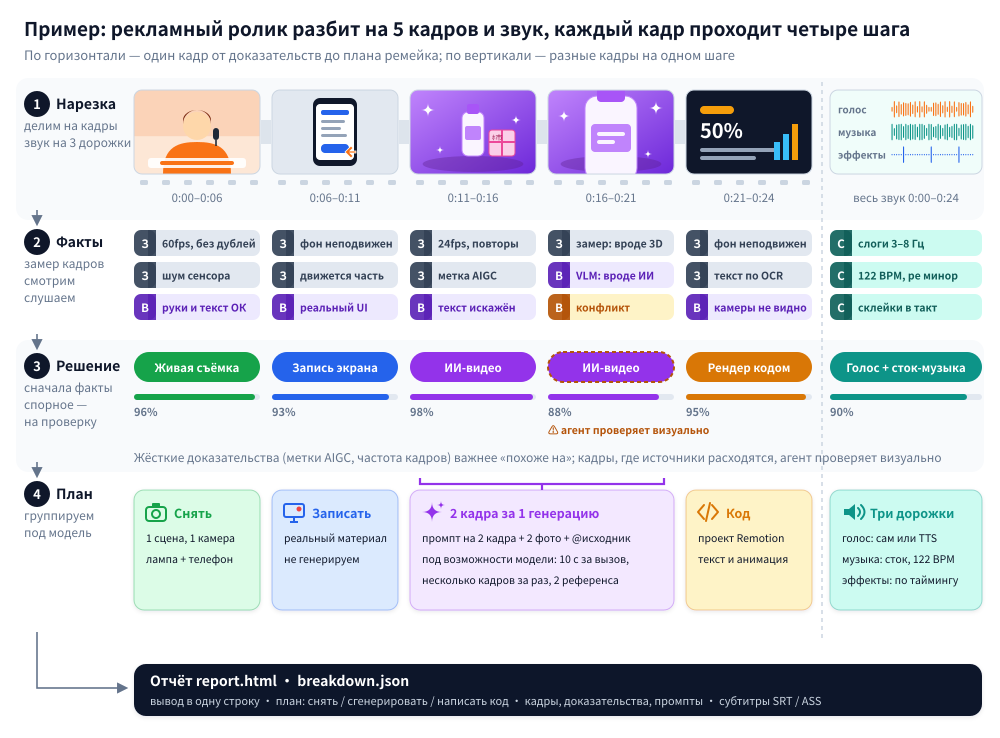

<div align="center">

<picture>
  <source media="(prefers-color-scheme: dark)" srcset="../docs/brand/logo-light.svg">
  
</picture>

Разбираем любое видео по косточкам.

Для каждого кадра: снят он на камеру, сгенерирован ИИ или собран кодом — и как сделать такой же.

[Сайт](https://www.reavideo.ai) | [中文](README_zh.md) | [English](../README.md) | Русский | [日本語](README_ja.md) | [한국어](README_ko.md) | [Español](README_es.md) | [Português](README_pt.md) | [Français](README_fr.md) | [Deutsch](README_de.md)


⭐ *Поставьте звезду — так о rea-ziyanai узнает больше людей.*
</div>

## Быстрый старт

rea-ziyanai рассчитан на работу через ИИ-агента. В Claude Code, Codex или любом другом агенте, который умеет запускать команды, напишите:

```text
Установи https://github.com/ziyan-ai/ZIYANmuse/tree/rea-ziyanai и разбери это видео: /path/to/video.mp4
```

Агент сам поставит CLI, разберётся, как с ним работать, и всё прогонит. Понадобятся ffmpeg и Python 3.10+.

<details><summary>Установка вручную</summary>

```bash
brew install ffmpeg            # sudo apt install ffmpeg
git clone --branch rea-ziyanai https://github.com/ziyan-ai/ZIYANmuse.git rea-ziyanai && cd rea-ziyanai
bash scripts/install_skill.sh  # ставит CLI (pip, иначе pipx / локальный .venv) и подключает skill → ~/.claude, ~/.codex, ~/.agents
rea-ziyanai --help
```

</details>

На выходе:

- краткая сводка по способу производства, звуку и реальным материалам
- план ремейка: что снять, что сгенерировать, что написать кодом
- подробный `report.html`: кадры по каждому плану, доказательства, промпты, заметки по камере и свету, разбор звука

Если подключить модель, которая понимает видео (подойдут Gemini или Doubao — просто дайте агенту endpoint и ключ), rea-ziyanai точнее отличает живую съёмку от ИИ и 3D и пишет восстановленный промпт для каждого кадра. Без модели тоже всё работает: если агент умеет смотреть картинки, спорные кадры он проверит сам.

> Отчёт пишется на том языке, на котором вы спросили (китайский или английский). Примеры отчётов ниже — на английском.

## Что можно разобрать

| Тип видео | Примеры | Что вы получите |
|---|---|---|
| Живая съёмка | «Говорящая голова», предметная съёмка на столе, демонстрация товара в руках, влог, обзор магазина | Локации и точки съёмки, крупность, движение камеры, свет (12 схем со списком оборудования), цветокоррекция |
| ИИ-видео | Text/image-to-video, ИИ-мини-сериалы, ИИ-клипы | Доказательства, восстановленный промпт для каждого кадра, как разбить кадры на генерации и какую модель взять |
| Аватар | Портрет, анимированный по аудио, липсинк | Какие кадры сделаны аватаром, какой портрет и какое аудио нужны |
| 3D / анимация | Научпоп на Blender / C4D, анимация товара, 2D-анимация, стоп-моушн | Чем делать: генерировать видеомоделью или рендерить из 3D-кода |
| Код / шаблон | Кинетическая типографика, демо интерфейсов, графики, карточки в стиле слайдов | Текст, раскладка и тайминги анимации — можно сразу собирать как проект Remotion |
| Запись экрана | Уроки по программам, демо сайтов | Какие фрагменты — реальный материал, который придётся записать самому |
| Смешанное / монтаж | ИИ-персонажи + интерфейс на коде + настоящая запись экрана; живая съёмка с ИИ-правками | Каждый кадр оценивается отдельно, потом всё собирается обратно по исходному таймлайну |

Кроме того, как сделана картинка, в каждом видео разбираются:

- Субтитры и оформленный текст: начало и конец каждой строки (экспорт в SRT / ASS), цвет, обводка и то, как текст появляется
- Стикеры, эмодзи, «картинка в картинке»: где стоят и сколько висят на экране
- Монтаж: где склейки, какой темп, попадают ли в бит
- Звук: живой голос или ИИ, ИИ-музыка или библиотечная и какой у неё BPM, где стоит каждый звуковой эффект
- Что придётся подготовить самому: записи экрана, скриншоты, фото товара

## Точность

Насколько точно определяется, как сделан кадр (с весом по длительности кадров):

| | Набор для настройки (15) | Отложенная выборка (16) | Перекодированные видео из WeChat (10) |
|---|---|---|---|
| Только инструменты (офлайн, бесплатно) | 98.3% | 99.6% / 98.9% | 88.6% |
| + визуальная модель (Gemini) | — | 99.6% / 99.8% | 99.6% |
| + визуальная проверка агентом | — | 99.6% / 99.8% | 100% |

Для отложенной выборки два числа: holdout (9 видео) и holdout2 (7 видео).

На исходных файлах обычно хватает одних инструментов. Видео, скачанные с платформ, пережаты, и шумовые признаки в них стёрты — чтобы снова подняться выше 99%, нужна визуальная проверка.

Реальные материалы находятся с точностью 97–99%, границы кадров определяются без ошибок. Цифры и как их воспроизвести — в [eval/RESULTS.md](../eval/RESULTS.md).

## Как это устроено



1. Нарезка: видео делится на кадры, звук — на голос, музыку и эффекты.
2. Сбор доказательств: замеры по кадрам (частота смены кадров, шум сенсора, двигается ли вся картинка как одна плоскость, метки AIGC в метаданных); анализ изображения (руки, текст, физика); анализ звука (BPM, тональность, пение или речь).
3. Решение: жёсткие улики вроде меток AIGC и частоты кадров весят больше, чем «похоже на». Если признаки противоречат друг другу, кадр помечается, и агент проверяет его глазами.
4. План ремейка: кадры группируются под реальные возможности целевой видеомодели — максимальную длину клипа, поддержку нескольких планов, число референсных изображений, которое она принимает.


## FAQ

<details>
<summary>Чем это отличается от ремейка в один клик вроде Hypit?</summary>

[Hypit](https://github.com/hypit-ai/hypit) берёт видео-референс и делает по нему новое: агент смотрит сетки кадров, чтобы понять оригинал, генерирует материал поддерживаемыми моделями (Seedance, PixVerse, MiniMax, Wan и другими), а субтитры и моушн-графику рендерит в HTML.

Как был сделан оригинал, он не выясняет. Живая съёмка идёт через тот же конвейер — сколько было камер и как стоял свет, он не скажет. Какое ИИ-видео он сможет повторить, зависит от доступных ему моделей: Kling и Veo нет, отдельного пути для аватаров и 3D нет, ИИ-музыки тоже нет — её придётся принести свою. Лучше всего у него получаются «говорящие головы», подкасты и интервью по сценарию, хуже — монтаж под музыку, моушн-графика для продуктов и кинематографичные короткометражки.

rea-ziyanai видео не рендерит. Он для каждого кадра определяет, снят тот, сгенерирован ИИ или собран кодом, и даёт по нему план съёмки, промпты или подход на коде. Если нужно быстро сделать что-то похожее, Hypit быстрее. Если нужно понять, как сделан оригинал, и недорого его переснять — берите rea-ziyanai. Вместе они тоже нормально работают.

</details>

<details>
<summary>Нужна ли модель, которая понимает видео? Сколько это стоит?</summary>

Нет. Режим «только инструменты» работает офлайн, бесплатно и на исходных файлах уже точный. Для пережатых видео с платформ подключите модель, которая понимает видео (подойдут Gemini или Doubao), или возьмите агента, который видит картинки; платите по тарифам этого сервиса. Автоматическая генерация видео (capsule-cinema) сначала делает бесплатный пробный прогон и вызывает платные модели только после вашего подтверждения.

</details>

<details>
<summary>Может ли он сам переснять всё видео?</summary>

Частично. Если установлен [capsule-cinema](https://github.com/JuneYaooo/capsule-cinema), ИИ-кадры генерируются и сами встают обратно на исходный таймлайн. Живые кадры вы снимаете по плану съёмки, а кадры на коде агент пишет как проект Remotion. Подробнее — в [docs/replicate.md](../docs/replicate.md).

</details>

<details>
<summary>Можно просто перезалить чужое видео?</summary>

Нет. rea-ziyanai нужен, чтобы разобраться в структуре, темпе и приёмах ролика, а потом переснять его на материале, на который у вас есть права. Не используйте чужие кадры, музыку, персонажей и внешность. При публикации соблюдайте правила платформ и местные требования к маркировке ИИ-контента.

</details>

## Документация

- [docs/what-it-detects.md](../docs/what-it-detects.md): всё, что он распознаёт (10 визуальных типов, камера, свет, цветокоррекция, звук)
- [docs/replicate.md](../docs/replicate.md): как делать ремейк по отчёту
- [docs/decompose.md](../docs/decompose.md): правила определения
- [docs/cli.md](../docs/cli.md): CLI и интеграция с capsule-cinema
- [rea_video/capabilities/](../rea_video/capabilities/README.md): таблицы возможностей моделей для видео, изображений и аудио — по ним подбираются модели для плана ремейка
- [eval/RESULTS.md](../eval/RESULTS.md): результаты оценки

Документация пока только на китайском.

## Сообщество

Вопросы, разборы и идеи для ремейков — в [GitHub Discussions](https://github.com/ziyan-ai/ZIYANmuse/discussions). Ещё мы есть в [Discord](https://discord.gg/dZj8D3GqWT). Китайскоязычные пользователи могут найти нас и на [linux.do](https://linux.do/).

Хотите, чтобы мы разобрали видео? Откройте [issue с запросом](https://github.com/ziyan-ai/ZIYANmuse/issues/new?template=request_breakdown.yml) со ссылкой — результат опубликуем как пример.

## Благодарности

Вдохновлено [REA (Reverse Engineer Anything)](https://github.com/morluto/rea): идти от того, что видно, к тому, как это сделано, подкреплять каждое утверждение доказательствами и проверять замерами.
