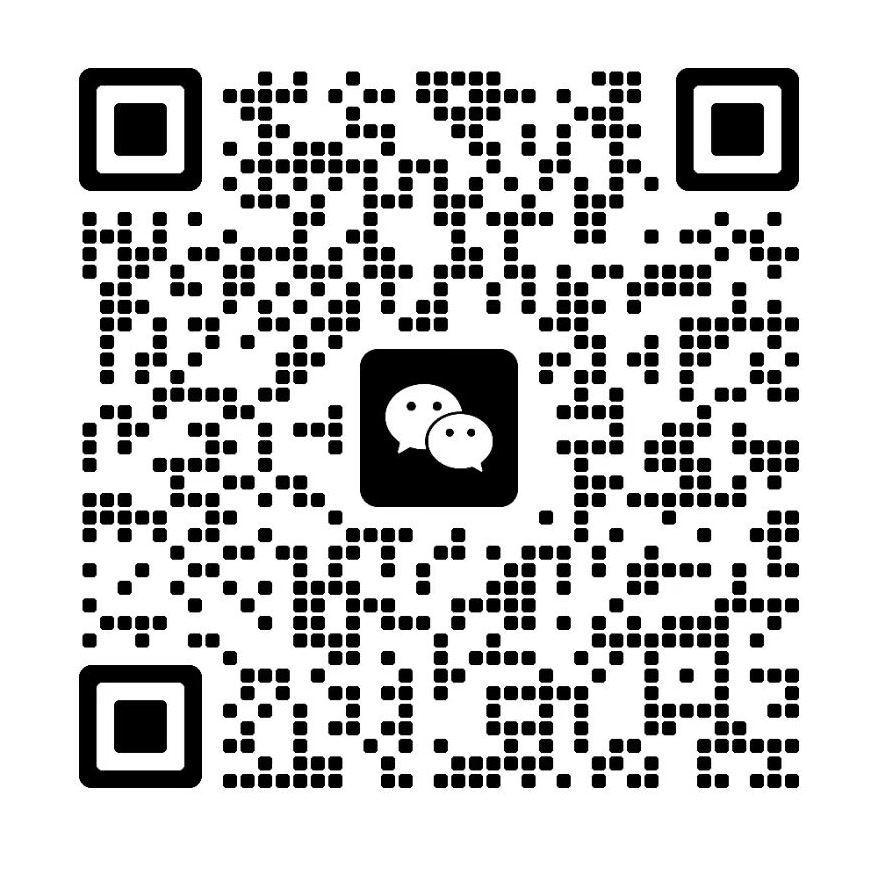

<div align="center">

<picture>
  <source media="(prefers-color-scheme: dark)" srcset="../docs/brand/logo-light.svg">
  
</picture>

逆向一切视频。

逐个镜头看一条视频是拍的、AI 生成的还是代码做的，再告诉你怎么复刻。

[上游官网](https://www.reavideo.ai) | 中文 | [English](../README.md) | [Русский](README_ru.md) | [日本語](README_ja.md) | [한국어](README_ko.md) | [Español](README_es.md) | [Português](README_pt.md) | [Français](README_fr.md) | [Deutsch](README_de.md)


⭐ *觉得有用就点个 Star 吧，能让更多人看到它！*
</div>

## 快速开始

rea-ziyanai 是给 AI agent 用的。打开 Claude Code、Codex 这类能跑命令的 agent，直接说：

```text
安装 https://github.com/ziyan-ai/ZIYANmuse/tree/rea-ziyanai ，然后拆解这条视频：/path/to/video.mp4
```

agent 会自己装好命令行工具、看懂拆解流程，然后一路跑完。电脑上需要有 ffmpeg 和 Python 3.10 以上。

<details><summary>手动安装</summary>

```bash
brew install ffmpeg            # sudo apt install ffmpeg
git clone --branch rea-ziyanai https://github.com/ziyan-ai/ZIYANmuse.git rea-ziyanai && cd rea-ziyanai
bash scripts/install_skill.sh  # 装命令行工具（pip 不让装时改用 pipx 或仓库内 .venv），并把 skill 链接到各 agent 目录
rea-ziyanai --help
```

</details>

跑完你会拿到：

- 一句话结论，概述制作方式、声音分析和真实素材
- 复刻方案，按实拍、AI 生成、代码分开写
- 完整报告 `report.html`：逐镜头截图、判断依据、提示词、拍法和声音拆解

还可以配一个能看视频的模型（Gemini、豆包都行），把接口地址和密钥给 agent 就好。配上之后实拍、AI、3D 分得更准，每个镜头还会反推出提示词。不配也能用，agent 自己能看图的话，会补看没把握的镜头。

## 能拆哪些视频

| 视频类型 | 拆出什么 |
|---|---|---|
| 实拍 | 机位、景别、运镜、布光和调色 |
| AI 视频 | 判断依据、逐镜提示词和模型适配的生成计划 |
| 数字人 | 数字人镜头识别及所需人像、音频素材 |
| 3D / 动画 | 判断使用视频生成或 3D / 代码渲染 |
| 代码 / 模板 | 文字、版式、动效节奏和 Remotion 规格 |
| 录屏 / 截图 | 识别真实录屏素材 |
| 混合 / 混剪 | 逐镜分析并按原时间线整理 |

除了画面怎么做的，每条视频还会拆：

- 字幕和花字：每句字幕的起止时间（可导出 SRT / ASS），花字用什么颜色、描边、怎么出场
- 贴纸、表情包、画中画：放在哪、停多久
- 剪辑：在哪切、节奏多快、有没有卡节拍
- 声音：真人还是 AI 配音，配乐是 AI 做的还是曲库的、多少 BPM，音效落在哪一下
- 要你自己准备的素材：录屏、截图、产品图

## 准不准

按镜头时长算的「制作方式」准确率：

| | 调参集（15 条） | 留出集（16 条） | 公众号转码视频（10 条） |
|---|---|---|---|
| 只用工具（离线、免费） | 98.3% | 99.6% / 98.9% | 88.6% |
| + 看图模型（Gemini） | — | 99.6% / 99.8% | 99.6% |
| + agent 看图复核 | — | 99.6% / 99.8% | 100% |

留出集的两个数分别是 holdout（9 条）和 holdout2（7 条）。

原始文件只用工具基本就够了。从平台下载的视频压缩过，噪点证据没了，要靠看图才能回到 99% 以上。

真实素材识别 97–99%，镜头切点全对。明细和复现方法在 [eval/RESULTS.md](../eval/RESULTS.md)。

## 怎么判断的


1. 切镜头：把视频按镜头切开，声音拆成人声、配乐、音效。
2. 取证据：测画面（帧率规律、噪点、是不是整张图在推拉、文件里有没有 AIGC 标识）；看图（手指、文字、物理细节对不对）；听声音（BPM、调性、是唱还是说）。
3. 综合判断：AIGC 标识、帧率这类硬证据优先于「看起来像」。几方意见冲突时标出来，交给 agent 看图复核。
4. 出复刻方案：按目标视频模型的实际能力分批，比如单次能生成多长、能不能一次出多个镜头、能吃几张参考图。


## 常见问题

<details>
<summary>和 Hypit 这类一键复刻工具有什么区别？</summary>

[Hypit](https://github.com/hypit-ai/hypit) 拿一条参考视频直接做一条新片：agent 看抽帧理解原片，再用它接入的模型（Seedance、PixVerse、MiniMax、Wan 等）生成画面，字幕和动效用 HTML 渲染出来。

它不区分原片是怎么做的。原片是实拍的，它照样按自己的流程重做，不会告诉你原片几个机位、怎么打光。AI 视频能做到什么程度，取决于它接了哪些模型：没有可灵、Veo，也没有专门的数字人和 3D；不生成 AI 配乐，配乐要自己准备。它最顺手的是口播、播客、采访这类跟着台词走的视频，纯音乐卡点、产品动效、电影感短片要弱一些。

rea-ziyanai 不直接出片。它先逐个镜头判断是拍的、AI 生成的还是代码做的，再分别给拍摄方案、提示词或代码思路。想马上做一条同款，用 Hypit 更快；想弄清原片怎么做、怎么少花钱做出来，用 rea-ziyanai。两个可以一起用。

</details>

<details>
<summary>一定要配看视频的模型吗？要花多少钱？</summary>

不一定。只用工具是离线、免费的，原始文件的准确率已经很高。从平台下载、压缩过的视频建议配一个能看视频的模型（Gemini、豆包都行），或者用本身能看图的 agent。模型按你用的服务计费。自动生成视频（capsule-cinema）会先免费试跑一遍，你确认后才会正式调用模型。

</details>

<details>
<summary>能自动把整条视频复刻出来吗？</summary>

可以做「换元素复刻」：用 [capsule-cinema](https://github.com/JuneYaooo/capsule-cinema) 的复刻配方，原片的运镜、动作、节奏和声音不变，把人物、产品、服装、场景换掉，整条自动生成并拼回原时间线（见上面的「复刻效果」）。
想按原样重做：AI 镜头可以自动生成；实拍镜头要你按拍摄方案去拍；代码镜头要 agent 写 Remotion 工程。详见 [docs/replicate.md](../docs/replicate.md)。

</details>

<details>
<summary>可以拿别人的视频直接搬运吗？</summary>

不可以。rea-ziyanai 用来学习视频的结构、节奏和做法，再用你有权使用的素材重新制作。请勿直接搬运他人的画面、音乐、角色或肖像。投放时请遵守平台规则和当地的 AI 生成内容标识要求。

</details>

## 文档

- [docs/what-it-detects.md](../docs/what-it-detects.md)：能拆出什么（10 类画面、拍法、打光、调色、声音）
- [docs/replicate.md](../docs/replicate.md)：拿到报告后怎么复刻
- [docs/decompose.md](../docs/decompose.md)：判断规则
- [docs/cli.md](../docs/cli.md)：命令行用法、和 capsule-cinema 的对接
- [docs/local-agent-setup.md](../docs/local-agent-setup.md)：Windows 本地 Agent 一键部署
- [rea_video/capabilities/](../rea_video/capabilities/README.md)：各家视频 / 图像 / 音频模型的能力表，复刻方案按它选模型

## 社区

欢迎来 [linux.do](https://linux.do/) 交流使用体验、视频分析和复刻思路。也可以加入 [Discord](https://discord.gg/dZj8D3GqWT) 聊天。

有想拆的视频，可以开一个[「求拆解」issue](https://github.com/ziyan-ai/ZIYANmuse/issues/new?template=request_breakdown.yml)，贴上链接并说明想了解什么。

也欢迎加微信交流群：拆视频时遇到的问题、判断制作方式的方法和复刻经验，都可以在群里交流、分享：

<div align="center">

</div>

## 致谢

思路来自 [REA（Reverse Engineer Anything）](https://github.com/morluto/rea)：从现象一路追到实现，结论都附证据，并且用测量来验证。
